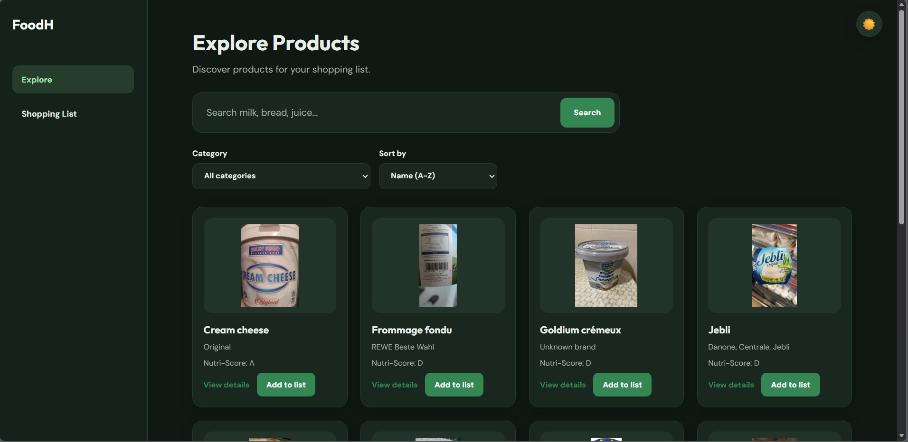

# FoodH

FoodH is a web app for planning grocery shopping. Search the [Open Food Facts](https://world.openfoodfacts.org) database for products, compare them by Nutri-Score and category, read their nutrition facts and ingredients, and build a shopping list that is saved in your browser.

NB: You might have to try again continously to get results!!

- **Live site:** https://www.te1vel.tech
- **Demo video:** https://youtu.be/Gv6OqcqaotI
- **Author:** te1vel



---

## Table of contents

1. [Features](#features)
2. [Tech stack](#tech-stack)
3. [APIs used](#apis-used)
4. [Project structure](#project-structure)
5. [Run locally](#run-locally)
6. [Deployment](#deployment)
7. [Optimizations](#optimizations)
8. [Error handling](#error-handling)
9. [Security](#security)
10. [Challenges and how I solved them](#challenges-and-how-i-solved-them)
11. [Known limitations](#known-limitations)
12. [Credits](#credits)

---

## Features

**Explore**
- Search products by name (for example milk, bread, juice). The page opens with a default search for "milk".
- Filter results by **category**. The category list is built from the products returned by each search.
- Sort results by **name (A-Z)**, **name (Z-A)** or **Nutri-Score (best first)**.
- Each result shows an image, name, brand and Nutri-Score.

**Product details**
- A dedicated page per product, opened by barcode.
- Shows brand, barcode, quantity, Nutri-Score, nutrition per 100 g / 100 ml (energy, fat, sugars, salt, proteins) and the ingredients list.

**Shopping list**
- Add a product from the results page or the details page. Adding the same product again increases its quantity.
- Change quantities, tick products as purchased, remove items, or remove all purchased items at once.
- A running count shows how many products are on the list and how many are purchased.
- The list is stored in the browser, so it survives a page reload.

**Interface**
- Light and dark mode. It follows the system setting on the first visit, and the toggle remembers your choice.
- Responsive layout for desktop, tablet and phone.
- Keyboard focus outlines, labelled form controls, and reduced-motion support.

## Tech stack

- HTML5, CSS3 and vanilla JavaScript (no frameworks, no build step)
- Browser `fetch` API for HTTP requests
- Browser `localStorage` for the shopping list, theme and response cache
- Nginx (static file server) on the two web servers and HAProxy on the load balancer

## APIs used

### Open Food Facts API

- **Website:** https://world.openfoodfacts.org
- **Official documentation:** https://openfoodfacts.github.io/openfoodfacts-server/api/
- **API key:** none required. The read endpoints used here are public, so there are no credentials to store or hide, and nothing sensitive is committed to the repository.

| Purpose | Endpoint | Parameters used |
|---|---|---|
| Search products | `GET /cgi/search.pl` | `search_terms`, `search_simple=1`, `action=process`, `json=1`, `page_size=12`, `fields=...` |
| Product details | `GET /api/v3/product/{barcode}.json` | barcode in the path |

The `fields` parameter limits each search result to the data the app displays (`code`, `product_name`, `brands`, `image_front_small_url`, `nutriscore_grade`, `categories_tags`, `quantity`), which keeps responses small.

**Rate limits** (from the official documentation): 10 requests per minute for search queries and 100 requests per minute for product reads. Because the requests are made directly from each visitor's browser, the limits apply per user. The caching described below exists to stay well inside these limits.

## Project structure

```
foodh/
├── index.html            # Explore page: search, filters, results
├── product.html          # Product details page (?barcode=...)
├── shopping-list.html    # Shopping list page
├── css/
│   └── style.css         # All styling, including dark mode and responsive rules
├── js/
│   └── app.js            # All behaviour: API calls, caching, rendering, list, theme
├── screenshots/          # Images used in this README
└── README.md
```

All three pages load the same `css/style.css` and `js/app.js`. The script checks which elements exist on the page (`#searchForm`, `#product`, `#shoppingList`) and runs only the code for that page.

## Run locally

No installation, API key or build step is needed. You only need a browser and an internet connection.

```bash
git clone <GITHUB_REPO_URL>
cd foodh
python3 -m http.server 8000
```

Open http://localhost:8000 in your browser.

Opening `index.html` directly from the file system also works in most browsers, but a local server behaves the same way as the deployed site, so I recommend it.

## Deployment

The app is a static site, so each web server only has to serve the files. The load balancer then shares incoming traffic between the two servers.

```
Browser → Lb01 (HAProxy, HTTPS) ─┬→ Web01 (Nginx) → /var/www/foodh
                                 └→ Web02 (Nginx) → /var/www/foodh
```

### 1. Deploy to Web01 and Web02

Run these steps on **both** web servers. The only difference is the `X-Served-By` name in step 3.

**Install Nginx and Git**

```bash
sudo apt update
sudo apt install -y nginx git
```

**Get the code**

```bash
sudo mkdir -p /var/www
sudo git clone <GITHUB_REPO_URL> /var/www/foodh
```

**Configure Nginx.** Create `/etc/nginx/sites-available/foodh`:

```nginx
server {
    listen 80 default_server;
    server_name _;

    root /var/www/foodh;
    index index.html;

    # Shows which server answered; use web-01 on Web01 and web-02 on Web02
    add_header X-Served-By web-01 always;

    # Compress text files to reduce transfer size
    gzip on;
    gzip_types text/css application/javascript text/plain;

    # Let browsers cache the stylesheet and script for one day
    location ~* \.(css|js)$ {
        expires 1d;
        add_header X-Served-By web-01 always;
    }

    location / {
        try_files $uri $uri/ =404;
    }
}
```

Nginx does not inherit `add_header` into a location block that defines its own, which is why the header appears twice.

**Enable the site and reload**

```bash
sudo ln -s /etc/nginx/sites-available/foodh /etc/nginx/sites-enabled/foodh
sudo rm -f /etc/nginx/sites-enabled/default
sudo nginx -t
sudo systemctl reload nginx
```

`nginx -t` checks the configuration before it is applied.

**Check each server directly**

```bash
curl -I http://35.178.200.121/
curl -I http://35.176.211.134/
```

Both must return `200 OK` with their own `X-Served-By` value. If a firewall (ufw) is active, port 80 must be allowed from the load balancer.

### 2. Configure the load balancer (Lb01)

HAProxy on Lb01 terminates HTTPS with the certificate for `www.te1vel.tech`, redirects plain HTTP to HTTPS, and shares requests between the two web servers. The relevant part of `/etc/haproxy/haproxy.cfg`:

```haproxy
frontend http_front
    bind *:80
    http-request redirect scheme https code 301 unless { ssl_fc }
    default_backend web_servers

frontend https_front
    bind *:443 ssl crt /etc/haproxy/certs/www.te1vel.tech.pem
    default_backend web_servers

backend web_servers
    balance roundrobin
    option httpchk GET /
    http-check expect status 200
    server 7364-web-01 35.178.200.121:80 check
    server 7364-web-02 35.176.211.134:80 check
```

- `http_front` answers on port 80 and redirects every request to HTTPS with a permanent (301) redirect.
- `https_front` decrypts HTTPS traffic using the certificate, then forwards plain HTTP to the web servers over port 80.
- `balance roundrobin` sends requests to Web01 and Web02 in turn.
- `option httpchk GET /` and `check` make HAProxy request the home page from each server regularly. A server that stops answering with `200 OK` is taken out of rotation automatically, and put back when it recovers.

Back up the file before editing, then validate and apply the change:

```bash
sudo cp /etc/haproxy/haproxy.cfg /etc/haproxy/haproxy.cfg.bak
sudo haproxy -c -f /etc/haproxy/haproxy.cfg && sudo systemctl reload haproxy
```

The `&&` means the reload only runs when the configuration check passes, so a typo cannot reach the live service. The check prints a warning about the DH parameter size for the certificate; it is harmless.

### 3. Test the load balancer

**Traffic is shared.** Run the request several times and watch the server name alternate:

```bash
for i in 1 2 3 4 5 6; do curl -sI https://www.te1vel.tech/ | grep -i x-served-by; done
```

Expected output alternates between `web-01` and `web-02`.

**Failover works.** Stop Nginx on one server (`sudo systemctl stop nginx` on Web01), repeat the command, and every response comes from Web02. Start Nginx again and both servers return.

**The app works through the load balancer.** Open `https://www.te1vel.tech`, search for a product, add it to the list and open the details page.

### 4. Updating the site

```bash
cd /var/www/foodh && sudo git pull
```

Run this on both servers so they always serve the same version.

## Optimizations

**Client side**
- **Response caching.** Search results are cached in `localStorage` for 30 minutes, so repeating a search costs no API request. Only the most recent 3 searches are kept, and only the first 12 products with the fields the app needs are stored, so the cache cannot fill the browser's storage.
- **Smaller responses.** Searches request a fixed list of fields and 12 results per page.
- **Local filtering and sorting.** Category filtering and sorting run in the browser on data already loaded, so they are instant and send no requests.

**Server side**
- Gzip compression for CSS and JavaScript.
- Browser cache headers (`expires 1d`) for the stylesheet and script.
- Two web servers behind a load balancer with health checks, so one server can fail without taking the site down.

## Error handling

| Situation | What the user sees |
|---|---|
| API is down, offline, or returns an error | "Could not load products. Check your internet connection." with a **Try again** button |
| API returns data in an unexpected shape | Treated as an error, same message and retry |
| Search matches nothing, or a category has no products | "No products found in this category." |
| Product page opened without a barcode | "No product selected." |
| Barcode not found | "Product not found." |
| Product detail request fails | "Could not load product details." with a **Try again** button |
| Missing name, brand, image or nutrition values | Fallbacks: "Unknown product", "Unknown brand", "N/A", and a placeholder image |
| Browser storage is full or unavailable | An alert explains the list could not be saved; theme and cache failures are ignored silently |
| Empty shopping list | A message prompts the user to add products |

## Security

- **No secrets.** The API needs no key, so there are no credentials in the code or the repository.
- **Cross-site scripting (XSS) protection.** Product data comes from a community-edited database, so every value inserted into the page goes through an `escapeHTML` function first, including product names, brands, image URLs and ingredients.
- **URL encoding.** Search terms and barcodes are passed through `encodeURIComponent` before they are placed in a URL.
- **Safe storage reads.** Data read from `localStorage` is parsed inside `try/catch` and checked to be the expected type before use.

## Challenges and how I solved them

<!-- EDIT: replace this section with your own real experience. Graders read it, so keep only what actually happened to you. -->

- **Staying inside the search rate limit.** The API allows 10 search requests per minute. I added a 30-minute response cache and filtered and sorted locally instead of querying again.
- **Inconsistent product data.** Many products have no image, brand, Nutri-Score or nutrition values. I added fallback text and images so the layout never breaks.
- **Untrusted content.** Because anyone can edit product data, I escaped everything before rendering it.
- **Browser storage limits.** Caching full API responses would fill `localStorage`, so I store a compact version of 12 products per search and keep at most 3 searches.
- **Load balancer testing.** A static site gives no hint of which server answered, so I added an `X-Served-By` header on each server to prove the traffic is shared.

## Known limitations

- Open Food Facts asks applications to identify themselves with a custom `User-Agent` header. Browsers do not allow JavaScript to set that header, so FoodH cannot send one.
- The `/cgi/search.pl` endpoint is part of the older API generation. It is the one that supports free-text search, but it may change in the future.
- The shopping list is stored per browser, so it does not sync between devices.
- Product data is community-contributed and can be incomplete or out of date.

## Credits

- **[Open Food Facts](https://world.openfoodfacts.org)** and its contributors for the product data and API. The database is available under the [Open Database License (ODbL)](https://opendatacommons.org/licenses/odbl/1-0/), its contents under the Database Contents License, and product images under Creative Commons Attribution-ShareAlike.
- **[Google Fonts](https://fonts.google.com):** DM Sans and Outfit.
- **[placehold.co](https://placehold.co):** placeholder images for products without a photo.
- **[Nginx](https://nginx.org)** and **[HAProxy](https://www.haproxy.org)** for serving and load balancing.